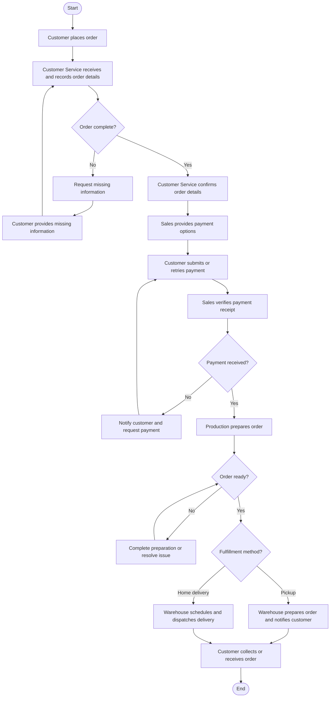

# Business Process Mapping: QuickService Delivery

**Order Management Process | Case Study**

**Author:** Rodrigo Garza García  
**GitHub:** [rogarzag](https://github.com/rogarzag)  
**Repository:** [business-process-mapping-quickservice-delivery](https://github.com/rogarzag/business-process-mapping-quickservice-delivery)  
**Process modeling tool:** Lucidchart  
**Learning context:** IBM Business Analysis

## Project overview

This case study maps the order management process of QuickService Delivery, a customer service company specializing in food and grocery delivery. The objective is to visualize the workflow from order placement to final fulfillment, clarify responsibilities across departments, and identify decision points that influence process execution.

The process covers order validation, payment, preparation, and fulfillment through customer pickup or home delivery.

## Process scope

- **Start:** The customer places an order.
- **End:** The customer collects the order or receipt of the home delivery is confirmed.
- **Participants:** Customer, Customer Service, Sales, Production, and Warehouse.

## Process flow

The following flowchart summarizes the activities, decision points, and exception paths documented in the case study.

## Key process controls

| Decision point | Control purpose |
|---|---|
| Order completeness | Ensures required order and customer information is available before confirmation |
| Payment receipt | Confirms payment before production proceeds |
| Order readiness | Checks that the order is prepared and ready for fulfillment |
| Fulfillment method | Determines whether the order is prepared for pickup or dispatched for home delivery |

## Modeling assumptions

The exception paths are explicit modeling assumptions added to make the workflow analyzable. The course scenario does not specify a payment cancellation policy or detailed exception-handling rules. The model therefore shows payment follow-up and retry, missing-information recheck, and production issue resolution without introducing an unsupported cancellation outcome.

## Tools and techniques

- **Lucidchart:** visual process modeling and flowchart design.
- **Flowchart notation:** start/end events, process activities, decision diamonds, and directional arrows.
- **Process analysis:** identification of participants, handoffs, decision points, and exception paths.

## Project files

The interactive diagram is available in Lucidchart:

[Open the QuickService Delivery order management flowchart](https://lucid.app/lucidchart/36c1ae40-1a47-4819-805f-63889a5205e3/edit?viewport_loc=-957%2C873%2C2289%2C1675%2C0_0&invitationId=inv_33bdba97-f296-4e62-a267-c171659295b9)

The accompanying case-study document and exported diagram are intended to be included in the `documents/` and `diagrams/` folders, respectively.

---

**Author:** Rodrigo Garza García  
[GitHub profile](https://github.com/rogarzag)
